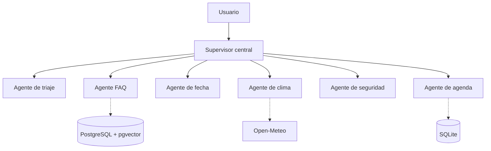
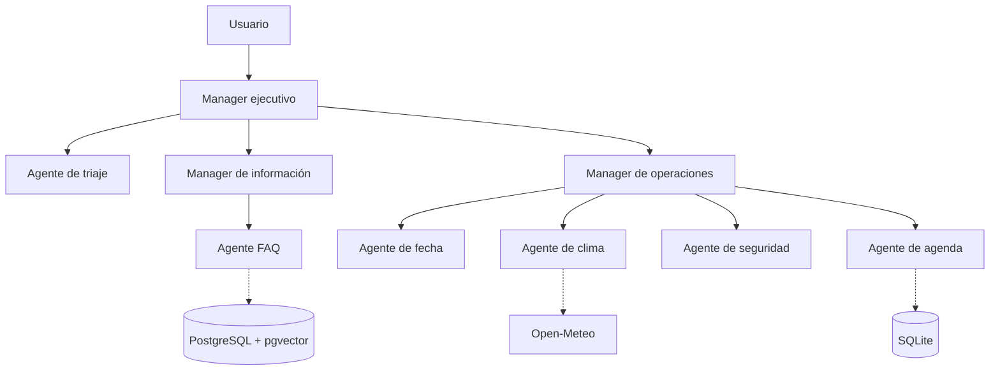
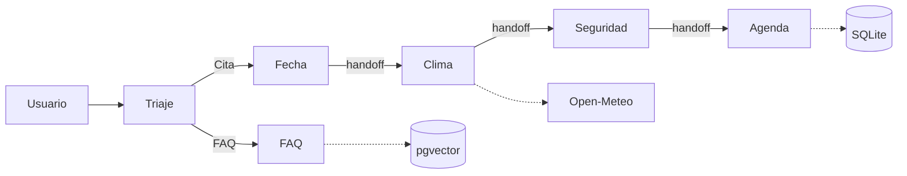

# Diagramas de agentes - Hoja 5

Los tres programas reutilizan exactamente los mismos agentes e integraciones. Las
flechas sólidas representan delegación o *handoff*; la línea punteada representa
el acceso de un especialista a una integración externa.

## Arquitectura centralizada

El supervisor conoce y controla la secuencia completa.

## Arquitectura jerárquica

El manager raíz delega por dominio y el manager de operaciones coordina el flujo
de reserva.

## Arquitectura descentralizada

No existe supervisor. Cada par conoce solamente el siguiente destino válido del
protocolo y le transfiere el contexto.
